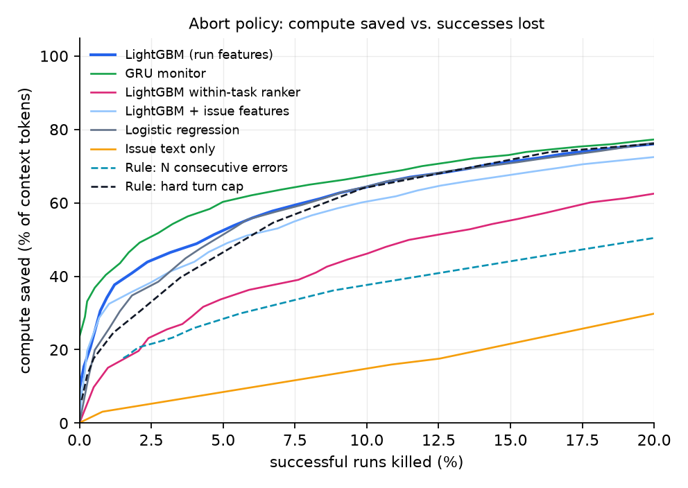
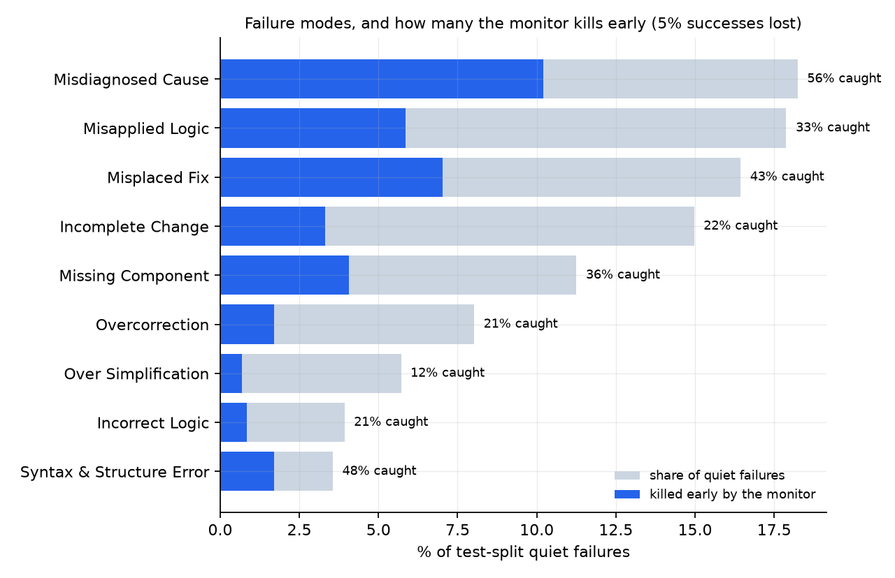
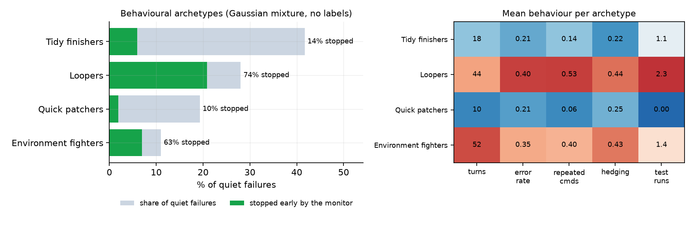

<p align="center">
  
</p>

<h1 align="center">Canary</h1>

<p align="center">Early warning for AI coding agents that are going to fail.</p>

<p align="center">
  <a href="https://github.com/moriowen/canary/actions/workflows/tests.yml"></a>
</p>

Coal miners carried a canary underground because it would go quiet long before the air turned deadly, and this project does the same job for AI coding agents: it watches a run as it happens and calls it early when the run is heading for failure, while there is still compute left to save.

## The problem

An AI coding agent is given a real GitHub issue and works in a loop. It thinks, runs a command, reads the output, and goes again, until it submits a patch. The repository's tests then decide whether the patch fixed anything.

Most of these runs fail. In [nebius/SWE-agent-trajectories](https://huggingface.co/datasets/nebius/SWE-agent-trajectories), 80,036 recorded attempts at 3,591 real issues, only 16.7% succeed. The failures are expensive in three ways:

- You only find out at the end. 74.8% of all runs finish normally, submit a patch, and still fail. The exit status for every one of them is `submitted`, which tells you nothing.
- Failed runs are the long ones. They loop, retry, and wander, so they use more turns than the runs that succeed.
- Late turns cost the most. Every step re-reads the whole transcript so far, so turn 40 costs far more than turn 4.

Today the options are to watch runs by hand or to set a fixed turn cap. A cap is blunt. It cuts off slow successes along with the failures, and it can't tell a run that is making progress from one stuck in a loop.

## What Canary does

Canary is a monitor that sits beside a running agent. After every turn it reads what the agent did (its actions, errors, edits, test runs, how much it repeats itself, and how its own reasoning sounds) and outputs one number: the probability that this run will end in a fix.

You choose how many successful runs you are willing to lose, say 2% or 5%. That choice sets a kill threshold. When a run's probability drops below it, you stop the run and give the compute to a fresh attempt or a different task.

Here is `canary watch` replaying a held-out run (some turns trimmed). The agent sets up a reproduction, then spends 40 turns alternating between the same two config commands:

```
iterative__dvc-2424  [swe-agent-llama-70b]  65 turns
kill line: P(success) < 0.014

  k=  0  p=0.117  #########         (before any turn)
  k=  1  p=0.096  #######           create      create reproduce_bug.py
  k=  3  p=0.109  ########          run     ERR python reproduce_bug.py
  k=  8  p=0.036  ###               run         python reproduce_bug.py
  k= 12  p=0.043  ###               other       dvc remote modify myremote url ssh://dummy@example.c
  k= 18  p=0.030  ##                other       dvc config --list
  k= 19  p=0.026  ##                other       dvc config remote.myremote
  k= 20  p=0.021  ##                other       dvc config --list
  k= 21  p=0.017  #                 other       dvc config remote.myremote
  k= 22  p=0.014  #                 other       dvc config --list  <-- KILL
  ...
  k= 64  p=0.004                    other       dvc config --list

outcome: FAILED. The monitor would have killed it at turn 22, saving 43 of 65 turns.
```

It is not always right. On another held-out run, a successful one, the agent had a string of rejected edits and the monitor would have killed it at turn 10, five turns before it solved the issue. That is the cost the loss budget is there to control.

Canary also has a second half: a failure taxonomy. An LLM reads each quiet failure in hindsight (the full transcript, the final patch, and the tests that still fail) and sorts it into a failure type. Joining that back to the monitor shows which kinds of failure are visible early and which only show up at the end.

## Results

All numbers are on held-out issues. Every attempt at a given issue is in the same split, so a model can't learn which issues are hopeless in training and get credit for it at test time. The SWE-agent test set has 16,140 runs over 718 issues.

Compute saved is measured in context tokens, the cost of re-reading the transcript at each step, and counts everything a killed run would have spent after the kill.

| SWE-agent monitor | AUROC at turn 5 | Same-issue AUROC at turn 20 | Compute saved, 2% of successes lost | 5% lost | 10% lost |
|---|---:|---:|---:|---:|---:|
| GRU over per-turn signals | 0.686 | 0.697 | **46.5%** | **60.3%** | **66.3%** |
| LightGBM on prefix features | 0.699 | 0.648 | 40.9% | 51.4% | 64.2% |
| LightGBM within-issue ranker | 0.601 | **0.716** | 15.1% | 33.7% | 44.6% |
| Logistic regression | 0.667 | 0.608 | 34.8% | 50.6% | 63.0% |
| Rule: hard turn cap | | | 24.6% | 39.6% | 64.0% |
| Rule: kill after N errors in a row | | | 19.6% | 25.8% | 36.1% |

<p align="center">
  
</p>

What the numbers say:

1. The monitor beats both rules where it matters. If you can afford to lose only 2% of successful runs, the GRU saves nearly twice the compute of the best turn cap (46.5% against 24.6%), and about half again as much at 5%. Once you accept losing 10%, a plain cap catches up, because on this agent long runs almost always fail.
2. Most early signal is about the issue, not the run. Over all test runs, the monitor reaches AUROC 0.70 by turn 5. Comparing only attempts at the same issue, which holds difficulty fixed, it is 0.54. The run-level signal grows as the run goes on and reaches about 0.70 by turn 20. Reporting both numbers is the point: the gap between them is how much of "failure prediction" is really "this issue is hard".
3. The agent's own words are the strongest single signal. The top LightGBM feature is how often the agent hedges in its reasoning ("seems", "might", "perhaps"). Next come how soon it first edits a source file, how long its reasoning runs, and how large its edits are.
4. It works less well on a stronger agent. On [OpenHands](https://huggingface.co/datasets/nebius/SWE-rebench-openhands-trajectories) runs (67,074 attempts, 47.9% solved, median 61 turns), the best monitor saves 11% of compute at 5% loss and the turn cap saves nothing, because successful runs there are long too. Checked one feature at a time, none of the behaviour signals separates attempts at the same issue, even at turn 30.
5. Transfer is one-way. A monitor trained on OpenHands keeps most of its value on SWE-agent: 41.7% compute saved at 5% loss, against 51.7% for a SWE-agent-trained model on the same features. Trained on SWE-agent and run on OpenHands, it is at chance. Re-expressing each feature as a percentile within its own agent's runs did not fix this.

## Why agents fail, and which failures show early

The runs that submit a patch and still fail all report the same exit status, so I had an LLM (Qwen3-30B-A3B through vLLM) read 14,644 of them in hindsight: the transcript, the final patch, and the tests that still fail. Each got a one-sentence diagnosis and a short label. A second pass had the LLM propose categories from the most common labels, then put every run into exactly one. Clustering the diagnoses with sentence embeddings did not work: the clusters followed the repository and the wording rather than the kind of mistake.

Joining the categories to the GRU monitor, at the threshold that stops 5% of successful runs, shows which failures are visible early:

| Failure type | Share of quiet failures | Stopped early | Mean turns | Hedging rate | Repeated commands |
|---|---:|---:|---:|---:|---:|
| Misdiagnosed cause | 18.2% | **56%** | 39 | 0.39 | 0.37 |
| Misapplied logic | 17.9% | 33% | 27 | 0.29 | 0.26 |
| Misplaced fix | 16.4% | 43% | 31 | 0.34 | 0.28 |
| Incomplete change | 15.0% | 22% | 20 | 0.27 | 0.19 |
| Missing component | 11.3% | 36% | 29 | 0.31 | 0.26 |
| Overcorrection | 8.0% | 21% | 21 | 0.26 | 0.19 |
| Over-simplification | 5.7% | **12%** | 18 | 0.23 | 0.15 |
| Incorrect logic | 3.9% | 21% | 22 | 0.26 | 0.22 |
| Syntax and structure error | 3.6% | 48% | 31 | 0.39 | 0.38 |

<p align="center">
  
</p>

The monitor catches agents that flail. A misdiagnosed run is long, hedges in its reasoning, and repeats itself, and more than half of them get stopped. It misses agents that are confidently wrong. An over-simplified or incomplete fix comes from a short, clean run with few errors, which looks like a run that succeeded, and only 12% to 22% of those get stopped. Those failures need a different signal, such as checking the patch itself, not watching the process.

### How failing runs behave, without labels

The LLM categories say why a run failed, using hindsight. A separate, unsupervised view asks how failing runs behave. Each of the 56,775 quiet failures is described only by its end-of-run behaviour: the share of each action type, error rate, repeated commands, hedging, edit sizes, test runs, and whether it reran its reproduction after editing. These features carry no repository or issue text, so clusters can't form around a codebase. After standardising and PCA (16 dimensions, 90% of variance), a Gaussian mixture picks four archetypes at the BIC knee.

| Archetype | Share | Turns | Error rate | Repeated cmds | Test runs | Stopped early |
|---|---:|---:|---:|---:|---:|---:|
| Tidy finishers: reproduce, edit, clean up, submit | 42% | 18 | 0.21 | 0.14 | 1.1 | 14% |
| Loopers: repeat commands, "still" and "again", rejected edits | 28% | 44 | 0.40 | 0.53 | 2.3 | **74%** |
| Quick patchers: about 10 turns, never test, never rerun | 19% | 10 | 0.21 | 0.06 | 0.0 | **10%** |
| Environment fighters: installs, malformed commands, long error streaks | 11% | 52 | 0.35 | 0.40 | 1.4 | 63% |

<p align="center">
  
</p>

Three things stand out:

1. Behaviour explains the monitor's blind spot better than the diagnosis does. Stop rates run from 10% to 74% across archetypes, against 12% to 56% across the LLM categories. Tidy finishers and quick patchers are 61% of quiet failures, and the monitor stops few of them, because their runs look like successful ones.
2. How a run fails and why it fails are close to independent. Agreement between the archetypes and the LLM categories is NMI 0.03. The two exceptions are that misdiagnosed causes concentrate among loopers and environment fighters, and incomplete changes among quick patchers.
3. The archetypes are regions of a continuum, not separate species. They are only moderately stable across random seeds (ARI 0.32), and HDBSCAN finds two dense clusters with 83% of runs left as noise. Where HDBSCAN does find structure it matches the mixture (ARI 0.97).

Still running: a ModernBERT model fine-tuned on the raw transcript text. Its results will be added here.

## How it works

```
nebius/SWE-agent-trajectories          ┐
nebius/SWE-rebench-openhands-...       ┘─> turns ─> prefix features at turn k ─> monitors ─> P(success | first k turns)
                                                                                    │
                                     kill threshold for a chosen loss budget  <─────┘
```

Each dataset is converted into the same per-turn record: what kind of action it was (view, search, edit, run, test, submit and so on), which file it touched, and what came back (tracebacks, rejected edits, missing commands, non-zero exit codes, test pass and fail counts). SWE-agent and OpenHands look nothing alike on the wire, but both reduce to that loop, which is what makes the transfer test possible.

A few rules keep the evaluation honest:

- A run only gets a prediction at turn k if it is still going at turn k. A run that already submitted can't be stopped, and its final `submit` would give the answer away.
- Nothing the monitor sees comes from after turn k. Exit status, the patch and the test logs are used only to label runs and to build the taxonomy.
- Issue-level statistics are kept out of the monitor. About 22 attempts share each issue, so something as innocent as the issue's length works as an ID, and models used it to memorise per-issue solve rates. Removing it improved held-out results.
- Every model has to beat two simple rules: a hard turn cap, and killing a run after N errors in a row.

The monitors are logistic regression and LightGBM on prefix features, a LightGBM ranker trained only to order attempts at the same issue, a GRU that reads one vector per turn and predicts after every step, and a fine-tuned ModernBERT that reads the transcript text. Training ran on Georgia Tech's PACE ICE cluster. The Slurm scripts are in `pace/`.

## Running it

```bash
python3 -m venv .venv
.venv/bin/pip install -e '.[train]'

canary build swe                 # download and parse 80k SWE-agent runs
canary build oh                  # same for 67k OpenHands runs
canary tabular swe               # logistic regression, LightGBM, ranker
canary seq swe                   # GRU monitor (GPU)
canary text swe                  # ModernBERT on transcripts (GPU)
canary ensemble swe
canary evaluate swe              # metrics, abort-policy curves, rule baselines
canary tabular swe --eval-on oh  # cross-agent transfer
canary taxonomy label swe        # LLM diagnoses of quiet failures (vLLM, GPU)
canary taxonomy propose_assign swe  # LLM proposes failure categories, then assigns each run
canary catch swe                 # which failure modes the monitor catches early
canary archetypes swe            # unsupervised behavioural archetypes (Gaussian mixture)
canary report                    # figures and tables into reports/
canary watch swe --failed        # replay a held-out run with the monitor's estimate
```

On PACE: clone into `~/scratch/canary`, run `bash pace/setup.sh`, then submit the jobs in `pace/` with `sbatch`.

## Layout

```
src/canary/
  turns.py          one record per agent action, for both SWE-agent and OpenHands
  features.py       prefix features at turn k, per-turn vectors for the GRU
  splits.py         train/val/test split by issue
  metrics.py        pooled and same-issue AUROC
  policy.py         abort-policy simulator: compute saved against successes lost
  taxonomy.py       LLM diagnosis and categories of quiet failures
  archetypes.py     unsupervised behavioural archetypes of quiet failures
  models/           tabular, GRU, ModernBERT, ensemble
  commands/         build, evaluate, catch, report, watch, peek
pace/               Slurm jobs for Georgia Tech's PACE ICE cluster
reports/            figures, tables and per-run summaries (tracked)
scripts/            one-off diagnostics
tests/
```

Raw outputs go to `results/` and data to `data/`. Neither is tracked.

## Data

[nebius/SWE-agent-trajectories](https://huggingface.co/datasets/nebius/SWE-agent-trajectories) and [nebius/SWE-rebench-openhands-trajectories](https://huggingface.co/datasets/nebius/SWE-rebench-openhands-trajectories), both CC-BY-4.0.
