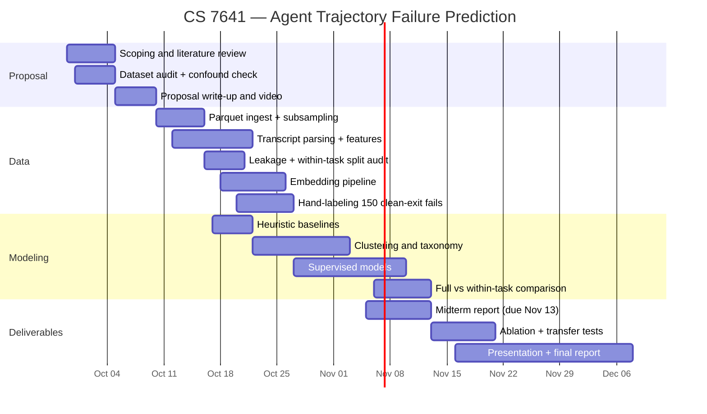

# Sample proposal: discovering and predicting semantic failure in LLM agent trajectories

Draft against the [Fall 2026 proposal spec](https://mahdi-roozbahani.github.io/CS46417641-fall2026/docs/grading/project-breakdown/proposal/). Sections 1 to 4 must total under 800 words.

v3 change: every number below is measured locally (`~/dev/Canary`) rather than estimated. Two measurements changed the design: a task-difficulty confound that would have invalidated the results, and the within-task subset that fixes it. Escalation was cut because the data does not support it.

Before submitting: verify every citation, replace teammate placeholders, and confirm the Award Eligibility Form choice.

---

## 1. Introduction / Background

LLM agents that interleave reasoning with tool calls [1], [2] fail often and expensively. A failed run consumes its whole budget and returns nothing, so a failure costs about what a success costs. Benchmarks such as SWE-bench [3] reduce each run to a single pass/fail bit, leaving how runs fail unexamined. Cost-aware routing such as FrugalGPT [4] picks a model once, before execution, and never intervenes in a run already underway.

We use public data rather than generating traces. The primary dataset, `nebius/SWE-agent-trajectories` [5], has 80,036 SWE-agent runs (CC-BY-4.0) over 3,591 GitHub issues. Each run alternates agent messages (reasoning plus one shell command) with environment output, median 31 messages; `target` records whether the issue was fixed and `exit_status` how the run ended. `SWE-bench/SWE-smith-trajectories` [6] adds 24,100 runs from a different scaffold and backbones, 39% resolved, for cross-scaffold transfer. `agent-evals/hal_traces` [7] adds 380 runs across 11 benchmarks for cross-domain transfer.

## 2. Problem definition

Only 16.7% of runs succeed. The dataset ships `exit_status`, a free but shallow label covering mechanical terminations: context exhaustion (24,594 runs), cost and format limits, and early exit (3,176 runs, none of which succeed). But 59,880 runs, or 74.8%, end as an ordinary `submitted`, produce a patch, and still fail. For all of those, `exit_status` carries no information by construction.

One measurement complicates the task. Of 3,591 tasks, 2,753 (76.7%) are never solved in any attempt. A model predicting failure from a transcript prefix could therefore score well by recognising that the task is hopeless rather than that the run is going badly. Those are different questions, and only the second one justifies aborting.

The problem has two parts. First, discover the semantic failure taxonomy inside the clean-exit majority, where no labels exist. Second, predict failure from the first *k* messages well enough to abort, evaluated so that task difficulty cannot explain the result.

The second part is tractable because 807 tasks (22.5%) have both outcomes, covering 34,922 runs of which 22,018 failed. Within that subset the same bug is sometimes fixed and sometimes not, which holds difficulty constant and isolates the behaviour of the run.

Two rules set the bar we must clear: a step-count cutoff and a consecutive-error rule. We report our margin over both.

## 3. Methods

We use three preprocessing steps. The first builds prefix-causal features over the first *k* agent turns, parsed from the transcript: command type (create, edit, open, search, run), repeat-command rate, error rate in environment output, longest run of consecutive errors, and output volume. A leakage guard rejects features referencing later steps; total length, `exit_status`, and `generated_patch` are excluded as post-hoc. The second embeds prefix text with a sentence encoder, pools it per run, and reduces it with PCA; UMAP [8] is for visualization only. The third groups splits by `instance_id` so no task spans train and test, holds out the both-outcome subset for evaluation, and rebalances for the 16.7% base rate.

For unsupervised learning we run K-Means and Gaussian Mixture Models over the prefix representations, choosing *k* by silhouette score [9] and BIC. These carry weight rather than decorate: they produce the taxonomy no label set provides, and cluster assignment feeds the supervised stage. Clustering runs on failures inside both-outcome tasks, so the groups describe behaviour rather than difficulty.

For supervised learning we compare L2 logistic regression, gradient-boosted trees, and a GRU over the message sequence, each against the two rules above.

## 4. Potential results and discussion

We use three metrics. Early-abort quality: precision, recall, and PR-AUC at k = 3, 5, and 10. Compute saved: messages saved against no intervention while holding the resolve rate within one point, as a Pareto curve. Cluster validity: silhouette score, plus purity against `exit_status` for mechanical failures and against 150 hand-labeled clean-exit failures.

The headline analysis compares full-dataset performance against within-task performance. The gap between them measures how much apparent skill is really task recognition. We also run a feature ablation, comparing handcrafted features against embeddings, and transfer tests to SWE-smith and HAL.

We expect modest gains over the consecutive-error rule at k = 5, narrowing as *k* grows, and a visible drop from full-dataset to within-task evaluation. Reporting that drop is one of the deliverables. A null within-task result would show that early transcripts carry little signal about the run itself, which is worth knowing.

On sustainability and ethics: aborting doomed runs cuts inference compute and the energy it uses. The risk on the other side is that over-aborting suppresses unusual but valid strategies, so we report abort rate per cluster and treat any cluster with both a high abort rate and a high true success rate as a failure of the method. All data is public and pre-anonymized, and no new agent execution is required.

---

## 5. References

> Verify venues and years before submission.

[1] S. Yao, J. Zhao, D. Yu, N. Du, I. Shafran, K. Narasimhan, and Y. Cao, "ReAct: Synergizing reasoning and acting in language models," in *Proc. Int. Conf. Learn. Represent. (ICLR)*, 2023.

[2] N. Shinn, F. Cassano, E. Berman, A. Gopinath, K. Narasimhan, and S. Yao, "Reflexion: Language agents with verbal reinforcement learning," in *Proc. Adv. Neural Inf. Process. Syst. (NeurIPS)*, 2023.

[3] C. E. Jimenez, J. Yang, A. Wettig, S. Yao, K. Pei, O. Press, and K. Narasimhan, "SWE-bench: Can language models resolve real-world GitHub issues?," in *Proc. Int. Conf. Learn. Represent. (ICLR)*, 2024.

[4] L. Chen, M. Zaharia, and J. Zou, "FrugalGPT: How to use large language models while reducing cost and improving performance," *arXiv:2305.05176*, 2023.

[5] Nebius, "SWE-agent-trajectories." Hugging Face. [Online]. Available: https://huggingface.co/datasets/nebius/SWE-agent-trajectories

[6] J. Yang et al., "SWE-smith: Scaling data for software engineering agents," *arXiv:2504.21798*, 2025. Dataset: https://huggingface.co/datasets/SWE-bench/SWE-smith-trajectories

[7] Agent-Evals, "HAL traces." Hugging Face. [Online]. Available: https://huggingface.co/datasets/agent-evals/hal_traces

[8] L. McInnes, J. Healy, and J. Melville, "UMAP: Uniform manifold approximation and projection for dimension reduction," *arXiv:1802.03426*, 2018.

[9] P. J. Rousseeuw, "Silhouettes: A graphical aid to the interpretation and validation of cluster analysis," *J. Comput. Appl. Math.*, vol. 20, pp. 53-65, 1987.

---

## Gantt chart

Sept 29 start. The deadline that binds is the presentation slot in the week of Nov 16, not the Dec 8 report deadline. Thanksgiving recess (Nov 23 to 27) and A3 (Nov 20) and A4 (Dec 8) are unavailable capacity.



If GT GitHub Pages does not render Mermaid, export the chart to an image. The rubric asks for a visible chart, not a code block.

## Contribution table

| Member | Proposal contribution | Primary project lane |
| --- | --- | --- |
| Atharva Mohite | Problem framing, confound analysis, baselines | Feature pipeline and supervised models |
| *Teammate 2* | Literature review, references | Clustering and taxonomy |
| *Teammate 3* | Dataset audit, schema verification | Data ingest and transcript parsing |
| *Teammate 4* | Metrics definition, results section | Transfer datasets and labeling protocol |
| *Teammate 5* | Gantt, website setup, video edit | Evaluation harness, website, visualizations |

---

## Appendix: modeling and training plan

Working notes. Not part of the 800-word submission. Source material for the Methods section, the midterm report, and the presentation.

### A.0 The training table

Every model works from one table. Each row is one agent run, collapsed to numbers drawn from only the first *k* turns:

| errors | max_error_streak | distinct_cmds | repeat_rate | out_chars | edit_count | solved |
| ---: | ---: | ---: | ---: | ---: | ---: | :--- |
| 3 | 3 | 2 | 0.60 | 1,412 | 1 | no |
| 0 | 0 | 5 | 0.00 | 903 | 2 | yes |
| 4 | 2 | 1 | 0.80 | 2,117 | 0 | no |

The label is `target`, taken straight from the dataset. Everything to its left is parsed from the transcript. Every supervised model here outputs a probability rather than a verdict; the abort decision comes from the threshold we place on it, which section A.6 covers.

There is one model per *k*. Values of 3, 5, and 10 produce three different tables and three separately trained models, because what you can tell after 3 turns is a different question from what you can tell after 10. Finding where useful signal first appears is the point.

### A.1 Baselines (rules, not models)

```python
abort_if = errors_in_first_k >= 3      # rule 1: consecutive-error
abort_if = turns_taken >= 15           # rule 2: step budget
```

Nothing is trained here. The rules are applied and measured, and every learned model is reported as a margin over them rather than as a standalone score.

### A.2 Supervised model 1: logistic regression

The model multiplies each feature by a learned weight, sums the results, and squashes the sum to a probability:

```
score  = w1·errors + w2·max_error_streak + w3·distinct_cmds + …
P(fail) = 1 / (1 + e^(−score))
```

It gives us an interpretable floor. The learned weights are themselves a finding: if `max_error_streak` carries the largest weight, that says something about what early failure looks like, and it belongs in the report. Training takes under a second. Expect it to beat the rules and lose to boosting.

### A.3 Supervised model 2: gradient-boosted trees

The model builds a small decision tree, measures where it is wrong, builds another tree to correct those errors, and repeats for hundreds of rounds.

It captures feature interactions that a linear model cannot, such as "3 errors is fine while the agent is still exploring, but 3 errors after it has started editing means it is lost." That is a conditional rule, which trees express naturally.

Expect this to win. Gradient boosting does well on tabular problems of this size, which matches the restaurant-review project on the award list, where XGBoost reached 0.91 weighted F1 over weaker baselines.

### A.4 Supervised model 3: GRU over the message sequence

The model reads turns in order, one at a time, carrying a running memory.

The feature table discards ordering, so these two runs look identical to models 1 and 2:

```
run A:  error → error → error → edit     (spiralling)
run B:  error → edit  → error → edit     (iterating normally)
```

Same error count, very different situations. A sequence model can separate them.

It may still lose to gradient boosting, since a few thousand rows is small for a sequence model. That result is worth reporting rather than hiding. The award-winning UAV state-estimator project found its MLP beat its LSTM and said so, which is part of why the work reads as credible.

### A.5 Unsupervised: K-Means and GMM

These predict nothing. They group.

K-Means takes a chosen *k*, assigns each run to its nearest cluster centre, recomputes the centres, and repeats until stable. Assignment is hard: one run, one group. A GMM assigns softly instead, so a run can be 70% "gave up early" and 30% "wrong file", which is closer to how real failures blend.

We do not know how many failure types exist, so we sweep k from 2 to 15 and select on silhouette score and BIC.

The algorithm returns cluster 0, 1, 2, and so on, which means nothing by itself. Someone then reads about 20 transcripts per cluster and names it by hand. That reading step produces the taxonomy, and no algorithm does it for us. The deliverable is a table that does not currently exist anywhere:

| Cluster | Name given | Runs | Solve rate |
| --- | --- | ---: | ---: |
| 0 | Never ran the tests | 14,200 | 2% |
| 1 | Edited the wrong file | 9,800 | 4% |
| 2 | Looped on one command | 7,100 | 1% |
| 3 | Fixed the symptom, not the cause | 11,500 | 6% |

Names and counts are illustrative. The real ones come out of the data.

Clustering runs on failures inside the 807 both-outcome tasks, so the groups describe run behaviour rather than task difficulty.

The clusters then do three jobs. The taxonomy is the discovery deliverable, since nobody has categorised the 59,880 clean-exit failures and `exit_status` calls every one of them `submitted`. Cluster identity also becomes a feature for the supervised stage, because a new run can be assigned to its nearest cluster from its first *k* turns, so the predictor stops merely counting errors and starts learning that runs resembling cluster 2 rarely recover. That link is what the deletion test checks. Third, abort rate per cluster audits the predictor: a cluster aborted 80% of the time but succeeding 6% of the time means a real strategy is being destroyed, which is the over-abort check in section 4.

The supervised and unsupervised halves answer different questions. The predictor asks whether a run will fail. Clustering asks what kind of run it is. Alone, the predictor says a run will probably fail; with clustering it says the run will probably fail and is failing by never running the tests. The first supports an abort, the second says what to fix.

### A.6 What each half actually outputs

The two halves answer different questions and return different things. The supervised model asks whether this run will fail. Clustering asks what kind of run this is. Neither answers the other.

The supervised model returns a probability, not a verdict:

```
P(fail) = 0.87   above a 0.8 threshold   ->  abort
P(fail) = 0.34   below it                ->  continue
```

The yes or no comes from the threshold we choose, which is why the threshold sweep in A.7 is a deliverable rather than an implementation detail.

Clustering returns no decision at all. Its raw output is a cluster number per run, which means nothing on its own. It becomes useful in three ways.

First, it produces the taxonomy, which is the finding. After reading about 20 transcripts per cluster and naming each one, the deliverable is a table that does not currently exist anywhere:

| Cluster | Name | Runs | Solve rate |
| --- | --- | ---: | ---: |
| 0 | Never ran the tests | 14,200 | 2% |
| 1 | Edited the wrong file | 9,800 | 4% |
| 2 | Looped on one command | 7,100 | 1% |
| 3 | Fixed the symptom, not the cause | 11,500 | 6% |

Those names and counts are illustrative. The real ones come out of the data. What matters is that nobody has categorised the 59,880 clean-exit failures, and `exit_status` calls every one of them "submitted".

Second, it feeds the supervised model. Clustering is not only retrospective: once the clusters exist, a new run can be assigned to its nearest cluster from its first *k* turns, so cluster ID becomes another column in the training table.

| errors | repeat_rate | … | cluster | solved |
| ---: | ---: | --- | :---: | :--- |
| 3 | 0.60 | … | 2 | no |

The predictor is then not only counting errors. It can learn that runs resembling cluster 2 rarely recover. This is what makes the unsupervised half load-bearing rather than decorative, and it is what the deletion test checks.

Third, it audits the predictor. Abort rate per cluster shows whether we are systematically killing one type of run. A cluster aborted 80% of the time that actually succeeds 6% of the time means we are destroying a real strategy, which is the over-abort check described in section 4.

Taken together, the supervised model alone says that a run will probably fail. With clustering it says that a run will probably fail and that it is failing by never running the tests. The first supports an abort. The second says what to fix, which is what gives the report something to say beyond a number.

### A.7 Training procedure

Split by group. This is not optional:

```python
from sklearn.model_selection import GroupShuffleSplit

splitter = GroupShuffleSplit(test_size=0.2, random_state=7641)
train_idx, test_idx = next(splitter.split(X, y, groups=df.instance_id))
```

With a mean of 22.3 attempts per task, a plain random split puts attempts at the same bug in both train and test. The model memorises the bug, scores brilliantly, and is worthless. This is the most likely way to invalidate the project without noticing.

Then fit, tune, and test once:

```python
model.fit(X_train, y_train)
p = model.predict_proba(X_val)[:, 1]   # threshold tuned here, on validation
```

The test set is touched once, at the end. Each round of peeking and adjusting makes the reported number less honest.

Never report accuracy. Since 83.3% of runs fail, a model that predicts "fail" for everything scores 83.3% accuracy while being useless. Use PR-AUC, and report precision and recall separately.

The threshold is where the decision actually gets made. The model emits a probability and the cutoff is a choice:

| Threshold | Behavior |
| --- | --- |
| 0.9 | aborts rarely, almost never kills a run that would have succeeded, saves little |
| 0.5 | aborts often, saves a lot, destroys some successful runs |

Sweeping that threshold produces the Pareto curve of compute saved against successes destroyed. The curve is the deliverable, not any single number.

Cross-validate, always grouped:

```python
from sklearn.model_selection import GroupKFold, cross_val_score

cross_val_score(model, X, y, groups=df.instance_id,
                cv=GroupKFold(5), scoring="average_precision")
```

### A.8 Compute cost

Logistic regression and gradient boosting run in seconds on CPU. A GRU on a few thousand rows takes minutes, also on CPU. The only slow step is embedding transcript text with a sentence encoder, and that cost is paid once and cached to disk. No GPU and no cloud spend.

### A.9 Build order

1. Feature table at k = 5. Unglamorous, and where the project actually lives.
2. The two baselines, to establish the number to beat.
3. Logistic regression, to confirm the rules are beaten and to read the weights.
4. Gradient boosting, the expected best result.
5. Clustering, the discovery half.
6. The GRU last, because it is most likely to disappoint.

Report every result twice, on the full dataset and within the 807 both-outcome tasks. The gap between the two measures the task-difficulty confound.

---

## Notes to self (delete before submitting)

### Measured locally, Aug 26 2026, via `src/01_metadata.py`

- 80,036 runs over 3,591 tasks. Mean 22.3 attempts per task, median 16, max 125.
- `target`: 13,389 solved (16.7%), 66,647 failed.
- Median trajectory length 31 messages.
- Models: llama-70b 74,792 (93%), llama-8b 4,053, llama-405b 1,191.
- `exit_status` by outcome: submitted 51,087 at 24.8% solved; submitted (exit_context) 21,026 at 3.4%; exit_context 3,568 at 0%; early_exit 3,176 at 0%; submitted_no_patch 1,066 at 0%; remainder 113.
- Clean-exit failures: 59,880 (74.8%).

### The two findings that changed the design

The bad news is the confound. Of 3,591 tasks, 2,753 (76.7%) are never solved in any attempt, and the median per-task solve rate is 0.000. A classifier could hit high accuracy purely by learning that a given repo or issue is hopeless, which is useless for an abort decision: it would fire at step 0 and never change its mind. This is the sharpest available critique of the project, and it needs to be addressed in the proposal rather than discovered in November.

The good news is the fix. There are 807 tasks (22.5%) containing both outcomes, covering 34,922 runs of which 22,018 are failures. Same bug, sometimes fixed, sometimes not. Evaluating there holds task difficulty constant, so whatever the model detects is about run behaviour. The subset is large enough to train on.

Reporting both numbers is the strongest move available. Full-dataset performance will look better, within-task performance is the honest one, and the gap between them is a measured quantity. That kind of self-damaging, quantified result appears in all the award-winning projects.

### Open risks

- Escalation is dead. Measured task overlap is 100 between 70B and 405B, and 528 between 70B and 8B. Too thin. The proposal commits only to continue or abort.
- 70B is 93% of rows, so claims about model scale are not supportable. Scope to 70B or stratify.
- The dataset is 5.6 GB across 12 shards. `01_metadata.py` reads only 4 columns and stays small; `02_sample.py` pulls 6,000 rows at 96 MB. Do not embed all 80k.
- SWE-smith and nebius are both in the SWE-bench family, so only HAL gives genuine domain transfer, and it needs the most parsing. Assign it early or cut it.
- `02_sample.py` oversamples successes to 35% for convenience. Re-weight before quoting rates.

### Framing reminders

- The argument in section 2 about `exit_status` being blind is what makes this a discovery problem rather than a classification exercise. Do not cut it for word count.
- The confound paragraph is the strongest paragraph in the proposal. A mentor who spots it first is a threat; a mentor who sees that you spotted it is an ally.
- Grouped splits and the leakage guard are where a mentor who knows ML will probe.

Related: [[Award-winning ML projects]], [[CS 7641 - Machine Learning]], [[Project direction and problem statement]]
